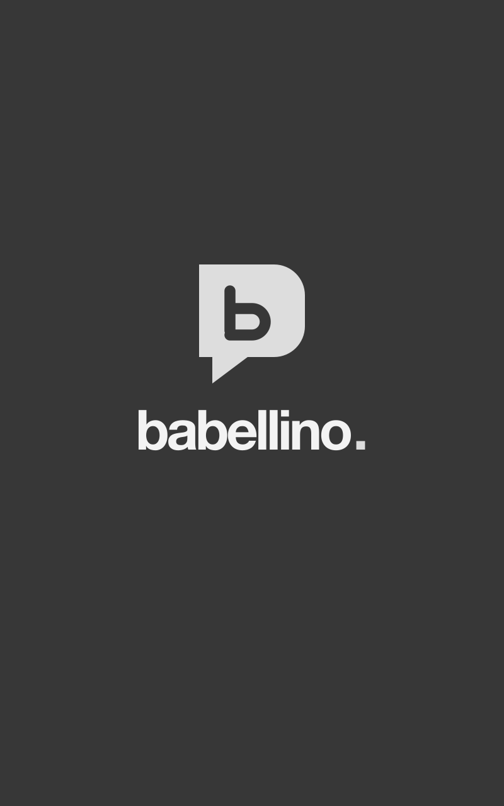
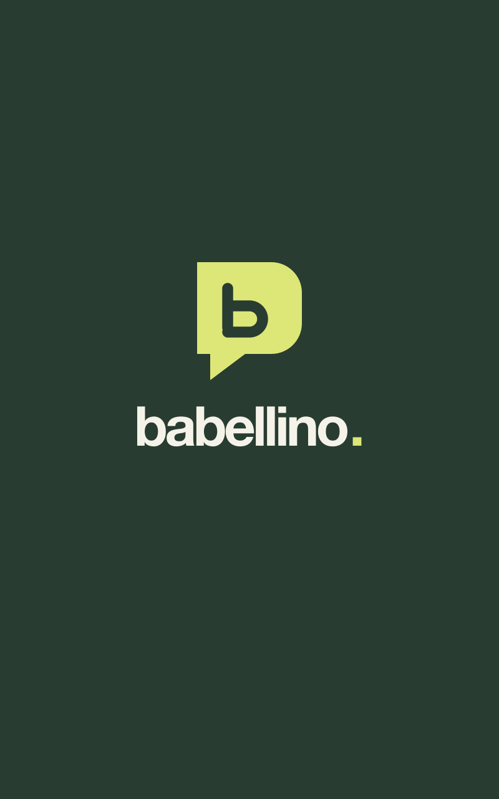

# Babellino boot splash

**Artwork draft for [issue #1](https://github.com/nxtamcode/babellino.com/issues/1).
Not yet approved or tested in the device boot pipeline.**

| Greyscale / U-Boot reference | Colour / application reference |
| --- | --- |
|  |  |

## Design

- 800 × 1280 pixels, portrait, with an opaque background.
- Existing website speech-bubble geometry and forest/cream/lime colours.
- Lowercase `babellino.` wordmark; no slogan, controls, status claims, or animation.
- Identical geometry at both stages. Only the palette changes, preserving the
  greyscale boot-stage diagnostic without a positional jump.
- No progress bar is baked into either image. Firmware owns progress and timing;
  this artwork adds no artificial wait to the approximately five-second boot.

The bubble occupies x=316–484, y=420–609. Lettering sits approximately within
x=220–580, y=651–716. A **proposed**, not confirmed, progress slot is
x=280, y=784, width=240, height=16; this area is blank in both exports.
Coordinate origin is the upper-left of the upright reference image.

## Files

| File | Purpose |
| --- | --- |
| `source.svg` | Editable layout; live Helvetica Neue Bold lettering. |
| `splash-colour.svg` | Standalone outlined colour artwork; no font dependency. |
| `splash-greyscale.svg` | The same paths in a neutral greyscale palette. |
| `splash-colour.png` | Reference raster: RGB, 8 bits/channel, no alpha, non-interlaced. |
| `splash-greyscale.png` | Reference raster: greyscale, 8 bits/pixel, no alpha, non-interlaced. |

PNG is a review/interchange format here, **not a claim of loader compatibility**.
Do not install these as boot assets until the firmware requirements are confirmed.

## Before final export

Confirm with the device maintainer:

1. Current splash files or screenshots, plus the format, bit depth/pixel format,
   palette, compression, and file-size limits for **each** boot stage.
2. Whether assets are stored upright at 800 × 1280 or pre-rotated for scanout.
3. Actual progress-bar coordinates and whether it is drawn separately; whether
   its colours are configurable. Move the proposed slot to match the existing UI.

Acceptance on hardware: no cropping or orientation errors; no positional jump or
blank flash at handoff; a recognisable greyscale screen if U-Boot stalls; a clear
progress bar in the application stage; no additional boot delay.

## Re-export and verify

The default export path uses the checked-in outlined colour SVG, so it needs no
fonts. Install `rsvg-convert` (librsvg) and ImageMagick, then run from the repo root:

```sh
python3 artwork/boot-splash/export.py
python3 artwork/boot-splash/verify.py
```

If editing `source.svg`, re-outline it on a machine with **Helvetica Neue Bold**
and fontconfig installed. The script refuses a font fallback:

```sh
python3 artwork/boot-splash/export.py --outline-source
python3 artwork/boot-splash/verify.py
```

Greyscale palette values use rounded Rec. 709 luma weights on the source RGB
channels: forest `#293c31` → `#373737`, lime `#dce777` → `#dddddd`, and cream
`#f5f3e9` → `#f3f3f3`. Both vector exports have the same geometry.

The verifier uses only Python's standard library and checks dimensions,
font-independent standalone paths, matching stage geometry, neutral greyscale,
PNG encodings, absence of transparency, and PNG chunk integrity. Actual-size
renders of both stages were also visually inspected. Device validation remains
pending. No private device source is included.
